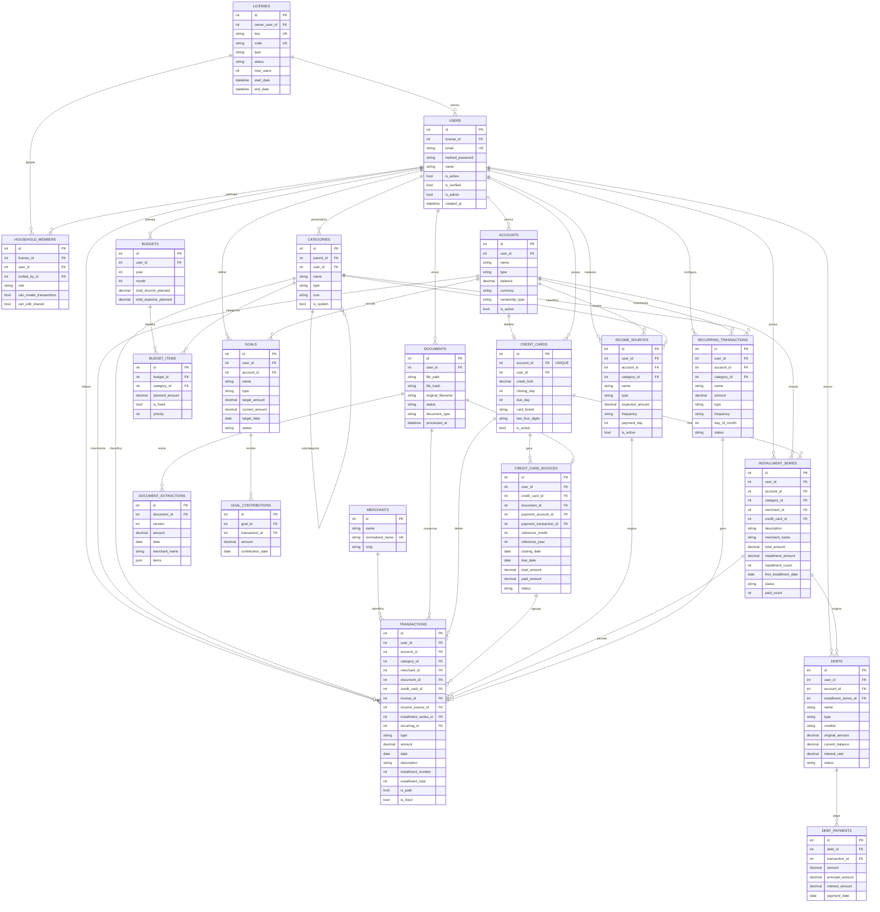

# Esquema do Banco de Dados - Biveto App

## Diagrama ER (Mermaid)



---

## Fluxo Principal: Cartao de Credito

```
┌─────────────────────────────────────────────────────────────────────────────────┐
│                         FLUXO DE CARTAO DE CREDITO                              │
└─────────────────────────────────────────────────────────────────────────────────┘

  ┌──────────┐      1:1       ┌─────────────┐
  │ ACCOUNTS │───────────────►│ CREDIT_CARDS │
  │          │                │              │
  │ type=    │                │ credit_limit │
  │ "credit_ │                │ closing_day  │
  │  card"   │                │ due_day      │
  └──────────┘                └──────┬───────┘
                                     │
                                     │ 1:N
                                     ▼
                        ┌────────────────────────┐
                        │ CREDIT_CARD_INVOICES   │
                        │                        │
                        │ reference_month/year   │
                        │ closing_date           │
                        │ due_date               │
                        │ total_amount           │◄──── Calculado das
                        │ status (open/closed/   │      transacoes
                        │         paid/overdue)  │
                        └───────────┬────────────┘
                                    │
                                    │ 1:N
                                    ▼
                          ┌─────────────────┐
                          │  TRANSACTIONS   │
                          │                 │
                          │ credit_card_id  │──────► Qual cartao
                          │ invoice_id      │──────► Qual fatura
                          │ amount          │
                          │ date            │
                          └─────────────────┘
```

---

## Fluxo de Parcelas (Installments)

```
┌─────────────────────────────────────────────────────────────────────────────────┐
│                         FLUXO DE PARCELAMENTO                                   │
└─────────────────────────────────────────────────────────────────────────────────┘

   Compra parcelada: R$ 1.200 em 12x de R$ 100

   ┌──────────────────────────────────────────┐
   │         INSTALLMENT_SERIES               │
   │                                          │
   │  description: "Loja X"                   │
   │  merchant_name: "Loja X"                 │
   │  total_amount: 1200.00                   │
   │  installment_amount: 100.00              │
   │  installment_count: 12                   │
   │  credit_card_id: 5  ◄───────────────────────── Vinculo com cartao
   │  first_installment_date: 2025-01-15     │
   │  status: "active"                        │
   │  paid_count: 3                           │
   └────────────────────┬─────────────────────┘
                        │
                        │ 1:N (gera 12 transacoes)
                        ▼
   ┌─────────────────────────────────────────────────────────────────────┐
   │                        TRANSACTIONS                                 │
   ├─────────────────────────────────────────────────────────────────────┤
   │  ID │ installment_number │ date       │ amount │ invoice_id         │
   ├─────────────────────────────────────────────────────────────────────┤
   │  1  │        1/12        │ 2025-01-15 │ 100.00 │     1 (Jan/2025)   │
   │  2  │        2/12        │ 2025-02-15 │ 100.00 │     2 (Fev/2025)   │
   │  3  │        3/12        │ 2025-03-15 │ 100.00 │     3 (Mar/2025)   │
   │ ... │        ...         │    ...     │  ...   │        ...         │
   │ 12  │       12/12        │ 2025-12-15 │ 100.00 │    12 (Dez/2025)   │
   └─────────────────────────────────────────────────────────────────────┘
```

---

## Calculo de Saldos

```
┌─────────────────────────────────────────────────────────────────────────────────┐
│                         CALCULO DE SALDOS                                       │
└─────────────────────────────────────────────────────────────────────────────────┘

  CONTA BANCARIA (bank/wallet):
  ┌────────────────────────────────────────────────────────────────┐
  │  Saldo = account.balance + SUM(transactions)                   │
  │                                                                │
  │  Onde: income = +amount                                        │
  │        expense = -amount                                       │
  └────────────────────────────────────────────────────────────────┘

  CARTAO DE CREDITO:
  ┌────────────────────────────────────────────────────────────────┐
  │  Limite Usado = SUM(transactions WHERE credit_card_id = X)     │
  │                                                                │
  │  Limite Disponivel = credit_card.credit_limit - Limite Usado   │
  │                                                                │
  │  Total da Fatura = SUM(transactions WHERE invoice_id = Y)      │
  └────────────────────────────────────────────────────────────────┘
```

---

## Relacionamentos Principais

### Hierarquia de Usuarios
```
LICENSE (Plano)
    │
    └── USERS (Usuarios do plano)
            │
            └── HOUSEHOLD_MEMBERS (Membros da familia)
```

### Hierarquia Financeira
```
USER
 ├── ACCOUNTS (Contas)
 │       ├── TRANSACTIONS (Movimentacoes)
 │       ├── CREDIT_CARDS (Detalhes de cartao)
 │       │       └── CREDIT_CARD_INVOICES (Faturas)
 │       │               └── TRANSACTIONS (Lancamentos da fatura)
 │       └── INSTALLMENT_SERIES (Series de parcelas)
 │               └── TRANSACTIONS (Parcelas)
 │
 ├── CATEGORIES (Categorias)
 │       └── CATEGORIES (Subcategorias)
 │
 ├── DOCUMENTS (Documentos/PDFs)
 │       └── DOCUMENT_EXTRACTIONS (Dados extraidos)
 │
 ├── INCOME_SOURCES (Fontes de renda)
 │       └── TRANSACTIONS (Recebimentos)
 │
 ├── BUDGETS (Orcamentos)
 │       └── BUDGET_ITEMS (Itens do orcamento)
 │
 ├── GOALS (Metas)
 │       └── GOAL_CONTRIBUTIONS (Aportes)
 │
 ├── DEBTS (Dividas)
 │       └── DEBT_PAYMENTS (Pagamentos)
 │
 └── RECURRING_TRANSACTIONS (Recorrencias)
         └── TRANSACTIONS (Transacoes geradas)
```

---

## Tipos e Status

### Account.type
- `wallet` - Carteira fisica
- `bank` - Conta bancaria
- `credit_card` - Cartao de credito
- `investment` - Investimento

### Transaction.type
- `income` - Receita
- `expense` - Despesa

### InvoiceStatus
- `open` - Aberta (acumulando)
- `closed` - Fechada (aguardando pagamento)
- `paid` - Paga
- `partial` - Parcialmente paga
- `overdue` - Vencida

### InstallmentSeriesStatus
- `active` - Em andamento
- `completed` - Todas pagas
- `cancelled` - Cancelada

### ownership_type
- `personal` - Pessoal
- `household` - Compartilhada (familia)
