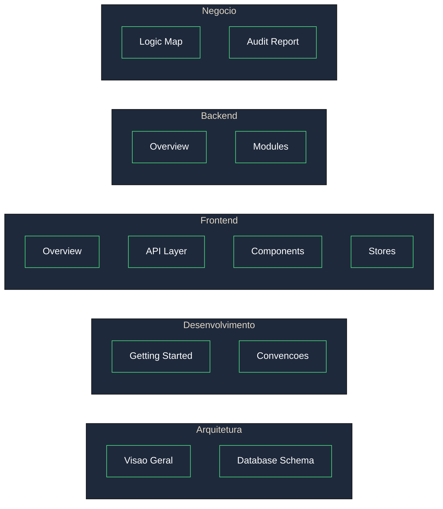
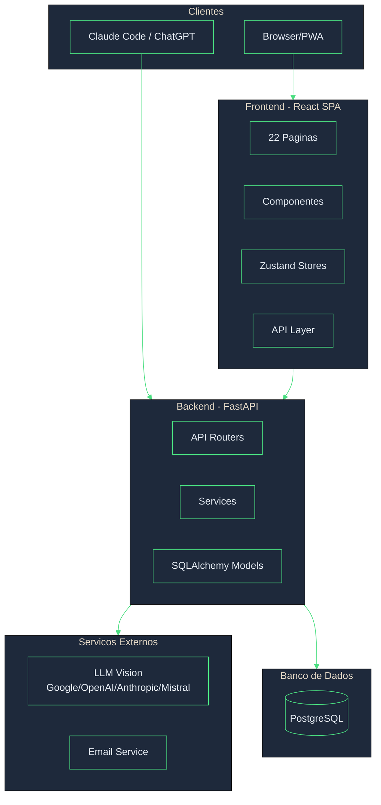

# Biveto App - Documentacao

Sistema completo de gestao financeira pessoal com suporte a familias, extracao inteligente de documentos via IA e assistente financeiro.

## Navegacao Rapida



## Indice de Documentos

### Arquitetura

| Documento | Descricao |
|-----------|-----------|
| [Visao Geral](./architecture/OVERVIEW.md) | Arquitetura do sistema, componentes e padroes |
| [Database Schema](./architecture/DATABASE_SCHEMA.md) | Esquema do banco de dados com diagramas ER |

### Desenvolvimento

| Documento | Descricao |
|-----------|-----------|
| [Getting Started](./development/GETTING_STARTED.md) | Configuracao do ambiente de desenvolvimento |
| [Convencoes](./development/CONVENTIONS.md) | Padroes de codigo, commits e workflow |

### Frontend

| Documento | Descricao |
|-----------|-----------|
| [Overview](./frontend/README.md) | Visao geral do frontend React |
| [API Layer](./frontend/API.md) | Documentacao da camada de API (Axios) |
| [Components](./frontend/COMPONENTS.md) | Documentacao dos componentes |
| [Stores](./frontend/STORES.md) | Estado global com Zustand |

### Backend

| Documento | Descricao |
|-----------|-----------|
| [Overview](./backend/README.md) | Visao geral do backend FastAPI |
| [Modules](./backend/MODULES.md) | Descricao dos 20 modulos |

### Negocio

| Documento | Descricao |
|-----------|-----------|
| [Logic Map](./business/LOGIC_MAP.md) | Mapa de regras de negocio e fluxos |
| [Audit Report](./business/AUDIT_REPORT.md) | Relatorio de auditoria tecnica |

### Integracoes

| Documento | Descricao |
|-----------|-----------|
| [Mistral Integration](./integrations/MISTRAL_INTEGRATION.md) | Integracao com Mistral OCR |

---

## Visao Geral do Sistema



## Tech Stack

### Backend
| Tecnologia | Versao | Proposito |
|------------|--------|-----------|
| Python | 3.12 | Linguagem |
| FastAPI | 0.109 | Framework web |
| SQLAlchemy | 2.0 | ORM (async) |
| PostgreSQL | 15+ | Banco de dados |
| Pydantic | 2.0 | Validacao |

### Frontend
| Tecnologia | Versao | Proposito |
|------------|--------|-----------|
| React | 18.2 | Framework UI |
| TypeScript | 5.3 | Tipagem |
| Vite | 5.1 | Build tool |
| Zustand | 4.5 | Estado global |
| TanStack Query | 5.18 | Cache de servidor |
| Tailwind CSS | 3.4 | Estilizacao |

### Integracoes IA
| Provider | Modelo | Uso |
|----------|--------|-----|
| Google | Gemini 2.0 Flash | Extracao de documentos |
| OpenAI | GPT-4o | Extracao (alternativo) |
| Anthropic | Claude 3.5 | Extracao (alternativo) |
| Mistral | OCR + Large | Extracao (recomendado) |

---

## Funcionalidades Principais

### 1. Extracao Inteligente de Documentos
- Upload de PDF, imagens, CSV, Excel
- Extracao automatica via LLM Vision
- Suporte a faturas de todos os bancos brasileiros
- Deteccao de parcelamentos
- Identificacao de servicos recorrentes (Netflix, Spotify, etc.)

### 2. Gestao de Cartoes de Credito
- Cadastro com templates pre-definidos
- Controle de limite e faturas
- Deteccao automatica de cartao em faturas
- Projecao de gastos recorrentes

### 3. Orcamento Mensal
- Planejamento por categoria
- Comparativo planejado vs realizado
- Copia entre meses
- Alerta de estouro

### 4. Metas Financeiras
- Tipos: poupanca, emergencia, quitacao, investimento
- Calculo de fundo de emergencia (Dave Ramsey)
- Calculo de PNIF (Gustavo Cerbasi)
- Contribuicoes e projecoes

### 5. Gestao de Dividas
- Cadastro com juros e parcelas
- Estrategia Snowball (menor saldo primeiro)
- Estrategia Avalanche (maior juros primeiro)
- Comparativo de estrategias

### 6. Familia/Household
- Convite de membros por email
- Compartilhamento de contas e transacoes
- Controle de permissoes
- Migracao de dados pessoais

### 7. Assistente IA
- Chat para analise financeira
- Sugestoes contextuais
- Insights sobre gastos

### 8. Integracao MCP
- API para Claude Code e ChatGPT
- Consultas de dados financeiros
- Contexto agregado para IA

---

## Quick Start

### Pre-requisitos
- Python 3.12+
- Node.js 20+
- PostgreSQL 15+
- API Keys (Google, OpenAI, ou Mistral)

### Backend

```bash
cd backend

# Criar ambiente virtual
python -m venv venv
source venv/bin/activate  # Linux/Mac

# Instalar dependencias
pip install -r requirements.txt

# Configurar variaveis de ambiente
cp .env.example .env
# Editar .env com suas configuracoes

# Rodar migracoes
alembic upgrade head

# Iniciar servidor
uvicorn app.main:app --reload --port 8000
```

### Frontend

```bash
cd frontend

# Instalar dependencias
npm install

# Configurar variaveis de ambiente
cp .env.example .env

# Iniciar servidor de desenvolvimento
npm run dev
```

### URLs

| Servico | URL |
|---------|-----|
| Frontend | http://localhost:3000 |
| Backend API | http://localhost:8000 |
| Swagger Docs | http://localhost:8000/docs |

---

## Estrutura do Projeto

```
biveto-app/
├── docs/                     # Documentacao (este diretorio)
│   ├── README.md            # Este arquivo
│   ├── architecture/        # Arquitetura do sistema
│   ├── development/         # Guias de desenvolvimento
│   ├── frontend/            # Docs do frontend
│   ├── backend/             # Docs do backend
│   ├── business/            # Regras de negocio
│   └── integrations/        # Integracoes externas
├── backend/                  # API FastAPI
│   ├── app/
│   │   ├── core/            # Configuracao, seguranca, deps
│   │   ├── models/          # Models SQLAlchemy
│   │   ├── modules/         # Modulos de funcionalidades
│   │   └── main.py          # Entry point
│   └── requirements.txt
└── frontend/                 # SPA React
    ├── src/
    │   ├── pages/           # Paginas/rotas
    │   ├── components/      # Componentes
    │   ├── stores/          # Zustand stores
    │   ├── services/        # Camada de API
    │   └── App.tsx
    └── package.json
```

---

## Contribuindo

Veja [Getting Started](./development/GETTING_STARTED.md) para configurar o ambiente e [Convencoes](./development/CONVENTIONS.md) para os padroes de codigo.

---

*Documentacao atualizada em Janeiro 2026*
